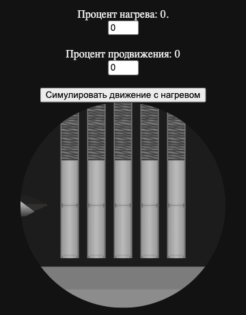

# Majestic test

A test assignment from 2022: an animated "drill the lock" mini-game scene built with Vue 3.



The scene is a cross-section of a pin tumbler lock with five pin stacks. Two values from 0 to 100 drive it:

- **Progress**: how far the drill has entered the cylinder. As it moves in, the upper pins and springs shift up and the pins tilt slightly. Each pin gets its own random tilt angle.
- **Heat**: a red gradient on the drill that grows from the tip.

The "Simulate" button runs progress from 0 to 100 while heat rises randomly.

## How it works

- `DrillCircle.vue` is the whole scene. Its size comes from the `width` and `height` props, and every part scales from them.
- `DrillComponents/Drill.vue` is the drill. Heat is a gradient clipped to the drill's shape with a CSS mask.
- `DrillComponents/Spring.vue` (SVG) and `Latch.vue` are the springs and pins, animated with `transform` based on progress.
- `MainPage.vue` has the inputs for manual control and the simulation.

## Stack

Vue 3 (Composition API, `<script setup>`), Vite, SCSS.

## Running

```sh
yarn install
yarn dev
```
